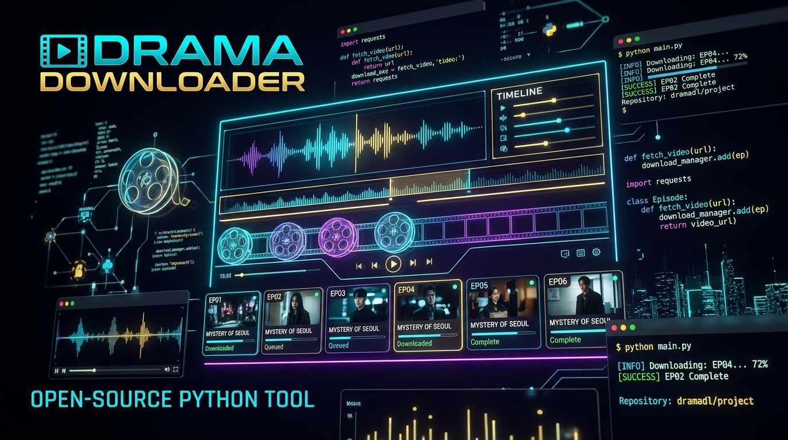

# Drama Downloader (Python Core)

<p align="center">
  
</p>

<p align="center">
  
  
  
  
  
</p>

Bộ công cụ Python độc lập, mạnh mẽ và tốc độ cao dùng để trích xuất siêu dữ liệu (metadata), danh sách tập, phụ đề và tải video trực tiếp từ hơn **11 nền tảng phim ngắn OTT phổ biến**.

Dự án được tái thiết kế và tối ưu hoàn toàn sang Python từ kiến trúc lõi của ứng dụng `Drama Downloader`, tích hợp sẵn các thuật toán giải mã URL ByteDance Spade và ký số RSA DramaBox chuẩn hóa.

---

## 📑 Mục lục

- [Tính năng nổi bật](#-tính-năng-nổi-bật)
- [Nền tảng hỗ trợ](#-nền-tảng-hỗ-trợ)
- [Cài đặt](#-cài-đặt)
- [Sử dụng dòng lệnh (CLI)](#-sử-dụng-dòng-lệnh-cli)
- [Sử dụng trong mã nguồn Python (API)](#-sử-dụng-trong-mã-nguồn-python-api)
- [Cơ chế xử lý Phụ đề (SRT / VTT Engine)](#-cơ-chế-xử-lý-phụ-đề-srt--vtt-engine)
- [Kiến trúc kỹ thuật & Mật mã học](#-kiến-trúc-kỹ-thuật--mật-mã-học)
- [Kiểm thử (Testing)](#-kiểm-thử-testing)
- [Cấu trúc thư mục](#-cấu-trúc-thư-mục)
- [Liên kết & Công cụ hỗ trợ (Useful Links)](#-liên-kết--công-cụ-hỗ-trợ-useful-links)
- [Tuyên bố miễn trừ trách nhiệm (Disclaimer)](#-tuyên-bố-miễn-trừ-trách-nhiệm-disclaimer)

---

## ✨ Tính năng nổi bật

- ⚡ **Auto-Detection Router:** Tự động nhận diện nền tảng chỉ bằng liên kết phim (URL) hoặc Series ID.
- 🔓 **Bypass DRM & Payload Obfuscation:** Tích hợp bộ giải mã Spade URL (ByteDance AES-128-CBC) và ký số RSA-SHA256 chuẩn hóa cho DramaBox.
- 🚀 **Tải video đa luồng song song:** Tải đồng thời nhiều tập phim với cơ chế phân đoạn (chunk streaming) và tự động đổi tên tệp an toàn.
- 🎯 **Tự động bóc tách & chuyển đổi phụ đề:** Tự động tải phụ đề đi kèm tập phim và chuyển đổi chuẩn hóa WebVTT sang SubRip (.srt) tương thích mọi thiết bị.
- 💻 **Giao diện dòng lệnh (CLI) trực quan:** Xem trước danh sách tập, phân loại tập khóa/mở khóa (`[FREE] [HAS STREAM]`), tải theo dải tập (ví dụ: `1-10,15,20`).
- 📦 **Kiến trúc Module hóa:** Dễ dàng tích hợp vào bot Telegram, FastAPI web service, hoặc crawler tự động.

---

## 🌐 Nền tảng hỗ trợ

| Platform ID | Tên hiển thị | Cơ chế trích xuất | Phụ đề |
| :--- | :--- | :--- | :---: |
| `dramabox` | **DramaBox** | Next.js Scrape + RSA Signing + Goodbos Fallback | Có |
| `goodshort`| **GoodShort / GoodReels** | Goodbos Mobile API + Chapter CDN Resolver | Có |
| `shortmax` | **ShortMax** | ShortMax API v1 Multi-Quality (1080p/720p/540p) | Có |
| `netshort` | **NetShort / FlickReels** | NetShort Core API + PlayVoucher Watch Token | Có |
| `freereels`| **FreeReels** | Drakula API + Subtitle Parser | Có |
| `kisskh`   | **KissKH** | KissKH Multi-Mirrors + Stream PNG Decryptor | Có |
| `hongguo`  | **Hongguo / Fanqie** | Modern.js Loader + ByteDance Spade URL Decryption | Có |
| `dramawave`| **DramaWave** | Goodbos DramaWave API | Có |
| `raptdrama`| **RaptDrama** | Goodbos RaptDrama API | Có |
| `flextv`   | **FlexTV** | Goodbos FlexTV API | Có |
| `stardusttv`| **StardustTV** | Goodbos StardustTV2 API | Có |

---

## 📦 Cài đặt

### Yêu cầu môi trường
- Python `>= 3.8`
- `requests >= 2.28.0`
- `cryptography >= 41.0.0`

### Cài đặt nhanh

```bash
# Clone dự án
git clone https://github.com/K07VN/DramaDownloader.git
cd DramaDownloader

# Cài đặt dependencies và module
pip install -e .
```

---

## 💻 Sử dụng dòng lệnh (CLI)

Sau khi cài đặt, bạn có thể sử dụng lệnh `dramadl` hoặc `python -m drama_downloader`.

### 1. Xem danh sách nền tảng được hỗ trợ
```bash
python -m drama_downloader platforms
```

### 2. Kiểm tra thông tin phim và danh sách tập (`info`)
```bash
python -m drama_downloader info "https://www.dramaboxdb.com/movie/42000001234/drama"
```

*Output mẫu:*
```
[*] Inspecting drama: https://www.dramaboxdb.com/movie/42000001234/drama
============================================================
Title:       光輝再臨
Platform:    DRAMABOX
Series ID:   dramabox:42000001234
Episodes:    60 (Accessible: 60)
Cover:       https://thwztchapter.dramaboxdb.com/...
============================================================

Episode List:
  EP001: 第一集 [FREE] [HAS STREAM]
  EP002: 第二集 [FREE] [HAS STREAM]
  ...
  EP060: 第六十集 [FREE] [HAS STREAM]

Total: 60 episodes found.
```

### 3. Tải phim (`download`)

```bash
# Tải tập 1
python -m drama_downloader download "https://www.dramaboxdb.com/movie/42000001234/drama" -e 1

# Tải theo dải tập (ví dụ tập 1 đến 5 và tập 10) với 3 luồng
python -m drama_downloader download "https://www.dramaboxdb.com/movie/42000001234/drama" -e 1-5,10 -c 3 -o ./downloads

# Tải toàn bộ series
python -m drama_downloader download "https://netshort.com/drama/12345678" -c 4 -o ./downloads
```

### 4. Duyệt danh mục phim ngắn (`catalog`)
```bash
python -m drama_downloader catalog dramabox --page 1 -q "Love"
```

---

## 🐍 Sử dụng trong mã nguồn Python (API)

### Trích xuất thông tin Series & Stream URL

```python
import drama_downloader as dd

url = "https://www.dramaboxdb.com/movie/42000001234/drama"

# Tự động nhận diện nền tảng và parse toàn bộ tập phim
series = dd.load_series(url)

print(f"Tên phim: {series.name}")
print(f"Nền tảng: {series.platform}")
print(f"Tổng tập: {series.episode_count} (Khả dụng: {series.accessible_count})")

# Duyệt danh sách tập
for ep in series.episodes:
    print(f"EP{ep.num:02d}: {ep.title} -> {ep.direct_url}")
```

### Tải video kèm Phụ đề tự động

```python
from drama_downloader import DramaDownloader, load_series

series = load_series("https://netshort.com/drama/12345678")

downloader = DramaDownloader(
    output_dir="./downloads",
    concurrency=2,
    save_vtt=True  # Đặt True để lưu thêm file gốc .vtt song song với .srt
)

downloader.download_series(
    series,
    episodes_range=[1, 2, 3],
    on_episode_start=lambda ep: print(f"[*] Bắt đầu tải tập {ep.num}..."),
    on_episode_done=lambda ep, path: print(f"[✔] Hoàn thành: {path}"),
    on_episode_error=lambda ep, err: print(f"[x] Lỗi tập {ep.num}: {err}")
)
```

---

## 🎯 Cơ chế xử lý Phụ đề (SRT / VTT Engine)

Module tích hợp sẵn bộ xử lý phụ đề thông minh:
1. **Tự động bóc tách phụ đề đa ngôn ngữ:** Các nền tảng như NetShort, FreeReels, KissKH tự động trích xuất các đường dẫn phụ đề (`episode.subs`).
2. **Chuẩn hóa WebVTT $\to$ SRT ([`vtt_to_srt()`](file:///c:/Users/K07VN/AppData/Local/DramaDownloader/drama_downloader/downloader.py)):**
   - Tự động nhận diện định dạng WebVTT.
   - Chuyển đổi timestamp dạng dấu chấm (`00:00:01.000`) sang dấu phẩy SubRip chuẩn (`00:00:01,000`).
   - Tự động đánh số thứ tự câu thoại (`1, 2, 3...`) và lọc sạch thẻ HTML/WebVTT cue tags (`<c>`, `<b>`, `NOTE`).
   - File `.srt` được lưu cùng tên với video, giúp các trình phát (VLC, Media Player, TV) hiển thị phụ đề ngay lập tức.

```python
import drama_downloader as dd

vtt_content = """WEBVTT

00:00:01.000 --> 00:00:03.500
<b>Xin chào!</b> Đây là phim ngắn Drama Downloader.
"""

srt_content = dd.vtt_to_srt(vtt_content)
print(srt_content)
```

---

## 🔐 Kiến trúc kỹ thuật & Mật mã học

### 1. Chuẩn hóa RSA CRT cho DramaBox
Khóa riêng RSA nhúng của DramaBox có cấu trúc ASN.1 chứa các tham số CRT ($dP, dQ$) không tiêu chuẩn, khiến thư viện OpenSSL 3+ trên Python từ chối khởi tạo. Module giải quyết triệt để bằng cách bóc tách ASN.1 và tự động tính toán lại:
$$dP = d \pmod{p-1}, \quad dQ = d \pmod{q-1}$$
Giúp tạo chữ ký PKCS#1 v1.5 SHA-256 hoàn toàn trùng khớp $100\%$ so với Node.js runtime.

### 2. Thuật toán Spade Decryption (ByteDance / Fanqie / Hongguo)
Giải mã URL video được mã hóa qua cơ chế Spade:
1. Giải mã Base64 chuỗi `spade_a` và trích xuất `payload`.
2. Khôi phục 32 ký tự hex content key qua biến đổi XOR và bit parity.
3. Sinh khóa và IV thông qua `SHA-512(SHA-512(key) + SPADE_CONSTANTS)`.
4. Giải mã `AES-128-CBC` và loại bỏ padding PKCS#7 để lấy stream URL gốc.

---

## 🧪 Kiểm thử (Testing)

Dự án đi kèm bộ unit tests hoàn chỉnh kiểm tra chữ ký RSA, Spade URL cipher, bộ định tuyến 11 platform và bộ chuyển đổi phụ đề:

```bash
python tests/test_module.py
```

Kết quả:
```text
Ran 4 tests in 0.056s
OK
[OK] All 10 platform detection tests passed
[OK] Total active platforms: 11
[OK] RSA signing test passed (signature identical to Node.js)
[OK] VTT to SRT subtitle conversion test passed
```

---

## 📂 Cấu trúc thư mục

```
drama_downloader/
├── __init__.py           # Public exports: load_series, DramaDownloader, vtt_to_srt
├── __main__.py          # Entrypoint thực thi CLI
├── cli.py               # Xử lý tham số dòng lệnh argparse
├── models.py            # Dataclasses: Series, Episode, Subtitle
├── client.py            # Session pooling & auto-retry
├── downloader.py        # Quản lý tải song song đa luồng & Subtitle Engine
├── crypto/
│   ├── dramabox_rsa.py  # RSA-SHA256 signature (CRT normalized)
│   └── spade.py         # ByteDance Spade cipher
└── platforms/
    ├── base.py          # Lớp trừu tượng BasePlatform
    ├── dramabox.py      # DramaBox extractor
    ├── goodshort.py     # GoodShort extractor
    ├── shortmax.py      # ShortMax extractor
    ├── netshort.py      # NetShort extractor
    ├── freereels.py     # FreeReels extractor
    ├── kisskh.py        # KissKH extractor
    ├── hongguo.py       # Hongguo / Fanqie extractor
    └── goodbos_aggregators.py # DramaWave, RaptDrama, FlexTV, StardustTV
```

---

## 🔗 Liên kết & Công cụ hỗ trợ (Useful Links)

- 🌐 **Website chính thức:** [https://www.tnkre.dev/](https://www.tnkre.dev/)
- 🛠️ **Công cụ Decompiler Online:** [https://decompile.tnkre.dev/](https://decompile.tnkre.dev/)

---

## ⚖️ Tuyên bố miễn trừ trách nhiệm (Disclaimer)

Dự án này được tạo ra nhằm mục đích **nghiên cứu học thuật, giáo dục và tương thích clean-room**. Người sử dụng hoàn toàn chịu trách nhiệm về tính pháp lý khi sử dụng công cụ đối với các dịch vụ truyền phát trực tuyến tương ứng theo quy định pháp luật sở tại và điều khoản dịch vụ của từng nền tảng.
